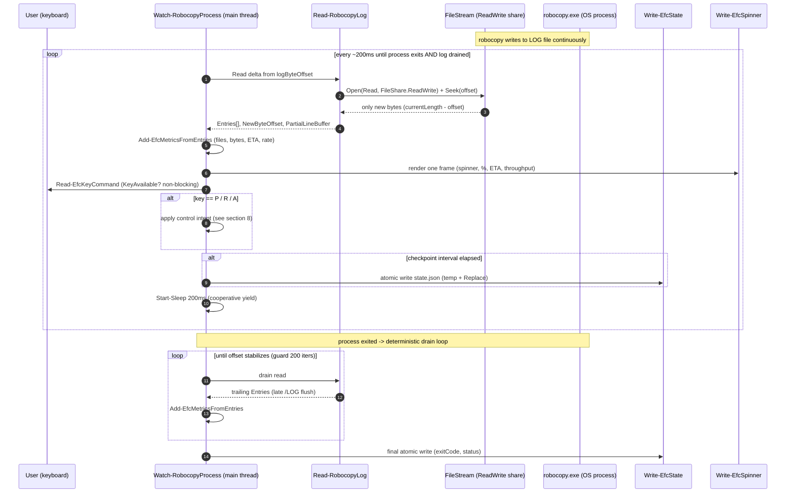
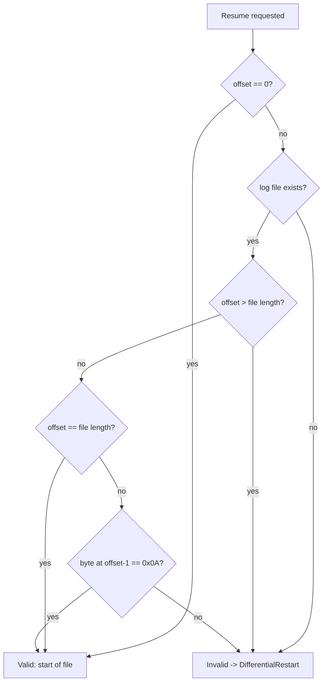
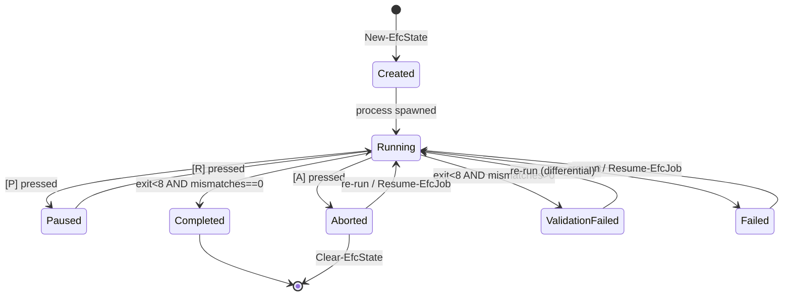
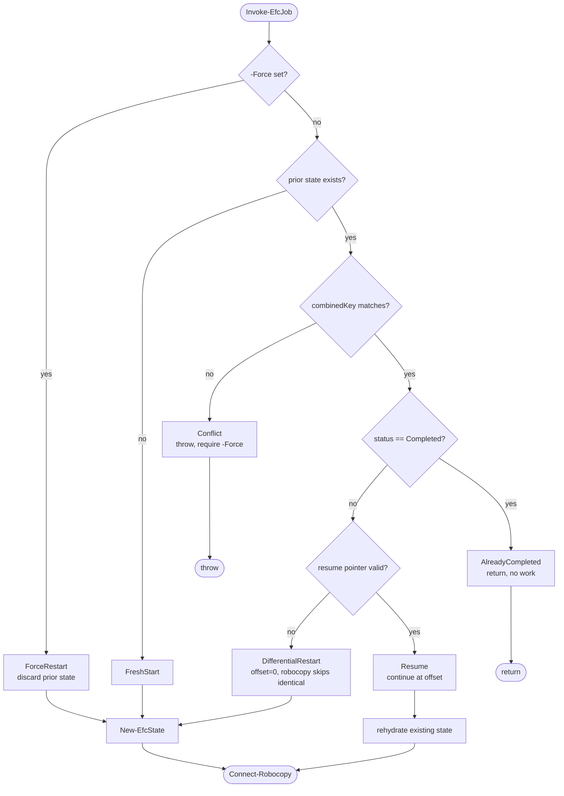
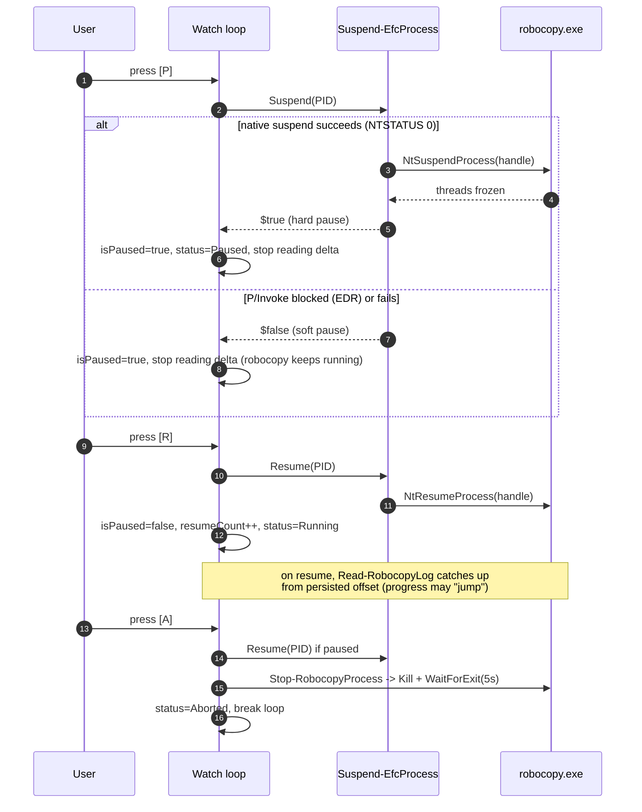
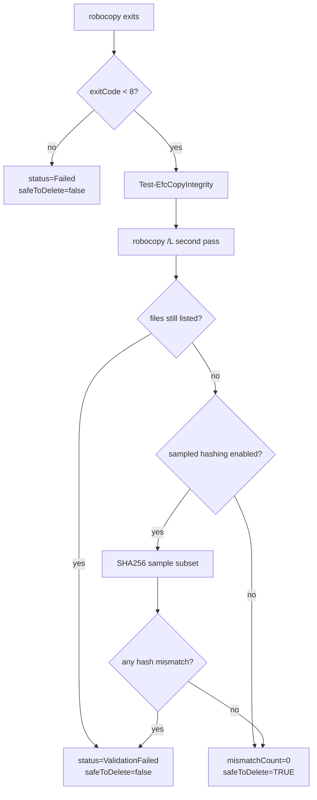
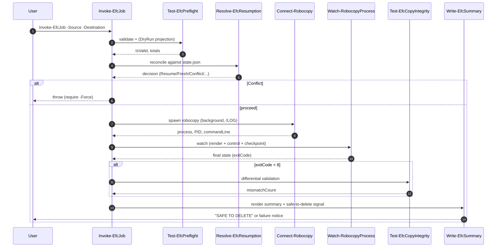

# Escape From Corporate - Architecture

This document is the technical reference for the internal design of `efc`. It is
intended for maintainers and contributors who need to understand *why* the engine
is structured the way it is, not just *what* it does. For usage, see the
[README](../README.md).

## Table of Contents

1. [Design Goals & Constraints](#1-design-goals--constraints)
2. [Layered Architecture](#2-layered-architecture)
3. [Component Responsibilities](#3-component-responsibilities)
4. [The Watch Loop (Sequence)](#4-the-watch-loop-sequence)
5. [Log Pointer Offset Mechanics](#5-log-pointer-offset-mechanics)
6. [State Lifecycle](#6-state-lifecycle)
7. [Resumption Decision Flow](#7-resumption-decision-flow)
8. [Pause / Resume / Abort Control](#8-pause--resume--abort-control)
9. [Integrity Validation & the Safe-to-Delete Gate](#9-integrity-validation--the-safe-to-delete-gate)
10. [Failure Modes & Mitigations](#10-failure-modes--mitigations)
11. [Testability Seams](#11-testability-seams)

---

## 1. Design Goals & Constraints

The entire architecture is shaped by a hostile execution environment: a locked-down
corporate Windows 11 laptop with **no administrator rights**, **no third-party sync
tools** (Rsync/Rclone blocked), and **no global module installation**.

| Goal | Architectural consequence |
|------|---------------------------|
| Move tens of GB / hundreds of thousands of files reliably | Delegate the actual copy to `robocopy.exe` (battle-tested, native) |
| Never block the UI while copying | Background process + non-blocking async log polling |
| Survive interruption and resume exactly | JSON state persistence with the Log Pointer Offset strategy |
| Prove the copy is exact before deletion | Post-copy differential validation gate |
| Run with zero admin | User-space only; ntdll suspend for own processes; no services |
| Be maintainable and testable | Public/Private split; injectable process/runner seams; full mocking |

The core insight: **`efc` is a control plane, not a copy engine.** Robocopy does the
data movement; `efc` orchestrates, observes, persists, and validates around it.

---

## 2. Layered Architecture

```
+-----------------------------------------------------------------------+
|  PUBLIC (CLI surface)                                                 |
|    Invoke-EfcJob  Get-EfcJobState  Resume-EfcJob  Clear-EfcState      |
+-----------------------------------------------------------------------+
                                |
                                v
+-----------------------------------------------------------------------+
|  ORCHESTRATION                                                        |
|    Invoke-EfcJob controller: preflight -> resolve -> spawn ->         |
|    watch -> validate -> notify                                        |
+-----------------------------------------------------------------------+
        |               |                |               |
        v               v                v               v
+-------------+ +---------------+ +--------------+ +----------------+
| VALIDATION  | | STATE         | | ENGINE       | | UI             |
| Preflight   | | New/Get/Write | | Connect      | | Spinner        |
| Integrity   | | Resolve       | | Watch        | | KeyCommand     |
|             | | Signature     | | Suspend      | | Summary        |
|             | | ResumePointer | | Stop         | | Format/Host    |
+-------------+ +---------------+ +--------------+ +----------------+
        |               |                |               |
        +---------------+--------+-------+---------------+
                                 v
                        +-----------------+
                        | LOG             |
                        | Read-RobocopyLog|
                        | ConvertFrom-Line|
                        +-----------------+
                                 |
                                 v
                        +-----------------+
                        | OS BOUNDARY     |
                        | robocopy.exe    |
                        | ntdll.dll       |
                        | FileStream      |
                        +-----------------+
```

**Dependency rule:** dependencies point downward and inward. The LOG layer never
calls UI; STATE never spawns processes; the only functions that touch the OS
boundary are `Connect-Robocopy`, `Suspend-EfcProcess`, `Read-RobocopyLog`, and the
validation runners - all of which expose an injectable seam for tests.

---

## 3. Component Responsibilities

| Component | Layer | Single Responsibility |
|-----------|-------|-----------------------|
| `Invoke-EfcJob` | Public | Lifecycle orchestration + user-facing contract |
| `Test-EfcPreflight` | Validation | Feasibility guards + DryRun projection (`robocopy /L`) |
| `Test-EfcCopyIntegrity` | Validation | Post-copy exactness check -> `safeToDeleteSource` |
| `New-EfcState` | State | Build canonical schema-1.0.0 state object |
| `Get-EfcState` / `Write-EfcState` | State | Atomic (de)serialization with sidecar recovery |
| `Get-EfcSignature` | State | Deterministic path signature for idempotent matching |
| `Resolve-EfcResumption` | State | Pure decision function (Resume/Force/Conflict/...) |
| `Test-EfcResumePointer` | State | Validate offset lands on an intact line boundary |
| `Connect-Robocopy` | Engine | Spawn background process, no pipe deadlock, file log |
| `Watch-RobocopyProcess` | Engine | The control loop: read/reconcile/render/control/checkpoint |
| `Add-EfcMetricsFromEntries` | Engine | Single source of truth for metric reconciliation |
| `Suspend-EfcProcess` | Engine | Fail-safe ntdll suspend/resume for pause |
| `Stop-RobocopyProcess` | Engine | Graceful termination on abort |
| `Read-RobocopyLog` | Log | Non-blocking delta read via FileStream, byte-accurate |
| `ConvertFrom-RobocopyLine` | Log | Compiled-regex line classification/parsing |
| `Write-EfcSpinner` / `Write-EfcProgress` | UI | In-place frame rendering with graceful degradation |
| `Read-EfcKeyCommand` | UI | Non-blocking keystroke capture (`KeyAvailable`) |
| `Write-EfcSummary` | UI | Final report + safe-to-delete notification |

---

## 4. The Watch Loop (Sequence)

The watch loop is the heart of the system. It runs on the **main PowerShell thread**
while robocopy runs as a **separate OS process**. There is no PowerShell runspace or
job involved - concurrency is achieved by delegating the heavy lifting to the OS
process and polling its side effects (the log file) cooperatively.



### Why this is non-blocking

- **No `WaitForExit()`** on the main thread. The loop checks `HasExited` per
  iteration and keeps rendering/reading.
- **No STDOUT pipe.** Robocopy writes to its own `/LOG` file; there is no pipe buffer
  to drain, so no deadlock is possible even on massive transfers.
- **No blocking read.** `Read-RobocopyLog` reads only `currentLength - offset` bytes
  and returns immediately; it never waits for more data.
- **No blocking key read.** `Read-EfcKeyCommand` calls `[Console]::KeyAvailable`
  first and only consumes a key when one is queued.

The `Start-Sleep 200ms` is the sole intentional yield: it keeps CPU near-idle while
preserving a responsive UI cadence (5 frames/second).

---

## 5. Log Pointer Offset Mechanics

This is the strategy that makes exact resumption possible. The persisted
`logPointer.logByteOffset` is the **byte position up to which the log has been fully
consumed and reconciled into metrics.**

### The partial-line problem

Robocopy may flush a buffer mid-line. A naive `ReadLine` loop would either block
waiting for the newline or mis-parse a truncated line. The solution splits every
delta into *complete lines* (fully terminated) and a *residual partial line* carried
forward.

```
Poll N reads delta bytes:  "...file9.txt\nNew File \t1024\tC:\data\file1"
                            |------ complete ------|--- partial (no \n yet) ---|
                                                    ^
                            PartialLineBuffer <-----+  (carried to poll N+1)

Poll N+1 delta:            "0.bin\nNew File \t2048\tC:\data\file11.txt\n"
Working buffer:            "New File \t1024\tC:\data\file10.bin\n..."
                            (partial prepended)  ^ now complete -> parsed
```

### Byte-accuracy with multibyte UTF-8

The offset advances by **bytes**, but PowerShell string operations work in
**characters**. For a path like `arquivo-ção.txt`, character count != byte count.
The authoritative formula measures the residual partial in bytes explicitly:

```
newPartialBytes = Encoding.UTF8.GetByteCount(newPartial)
NewByteOffset   = ByteOffset + (bytesReadThisPass - newPartialBytes)
```

The prior `PartialLineBuffer` came from bytes **already counted** in `ByteOffset`, so
it is not double-counted: we only add `(read - newPartialBytes)`, where `read` is the
delta of *this* pass.

### Resume integrity

On resume, `Test-EfcResumePointer` verifies the byte immediately before the offset is
a newline (`0x0A`), or the offset is `0` / exactly EOF. If the log was truncated or
rotated (offset past EOF, or mid-line), the pointer is rejected and the caller falls
back to a `DifferentialRestart` (offset reset to 0), trusting robocopy to skip
already-copied identical files.



---

## 6. State Lifecycle

The `state.json` file at `%LOCALAPPDATA%\EscapeFromCorporate\state.json` is the single
persistent artifact. Its `status` field is the primary state machine.



### Atomic persistence

`Write-EfcState` never writes `state.json` in place. It writes `state.json.tmp`, then:

- If a prior file exists: `[System.IO.File]::Replace(tmp, primary, backup)` -
  atomic on NTFS, with a `.bak` sidecar for crash recovery.
- Otherwise: `[System.IO.File]::Move(tmp, primary)`.

`Get-EfcState` mirrors this: if `state.json` is missing but `state.json.tmp` exists
(a crash mid-rename), it salvages the temp file. Corrupt/partial JSON returns `$null`
(treated as a fresh start) rather than throwing.

### Checkpoint throttling

The watch loop persists at most once per `resumption.checkpointIntervalSeconds`
(default 15s), not every iteration. This bounds disk I/O to ~4 writes/minute even at
5 frames/second, while keeping the resume granularity acceptable (worst case: replay
~15s of already-copied files, which robocopy skips as identical).

---

## 7. Resumption Decision Flow

`Resolve-EfcResumption` is a **pure function**: given the existing state and the
request, it returns a decision without side effects. `Invoke-EfcJob` applies it. This
separation keeps the decision matrix fully unit-testable in isolation.



The `combinedKey` is `SHA1(normalizedSource)[0..8] + '-' + SHA1(normalizedDest)[0..8]`.
Path normalization (lowercase, trimmed trailing separators) means `C:\Data\` and
`c:\data` produce the same key - the job identity is robust to cosmetic path
differences.

---

## 8. Pause / Resume / Abort Control

Robocopy has **no native pause**. `efc` implements true suspension via
`NtSuspendProcess` / `NtResumeProcess` from `ntdll.dll` (callable without admin for
processes the current user owns), with a soft-pause fallback.



### Hard pause vs soft pause

- **Hard pause** (native suspend succeeded): robocopy threads are frozen; no CPU, no
  disk, no network. The transfer is truly halted.
- **Soft pause** (fallback): robocopy keeps running in the background, but `efc` stops
  consuming the log delta. On resume, the reader catches up from the persisted offset.
  No data is lost; the only visible effect is a progress "jump."

`Suspend-EfcProcess` is **contractually fail-safe**: it returns `[bool]` and never
throws, because pause is a best-effort UX feature that must never crash an in-flight
transfer. This matters in corporate environments where an EDR agent may block ntdll
P/Invoke.

---

## 9. Integrity Validation & the Safe-to-Delete Gate

The `safeToDeleteSource` flag is the most consequential field in the entire system -
it is the signal that authorizes the user to delete their source data. It defaults to
`false` and only flips to `true` under strict conditions.

Optional **sampled SHA256 hashing** is now exposed on the public surface via
`Invoke-EfcJob -SampleHashCount <n>` (0-10000), which flows through to
`Test-EfcCopyIntegrity`. The chosen count and the resulting
`hashSamplesChecked` / `hashMismatches` are persisted under `state.json`
`validation.*` for audit traceability.



### The differential validation principle

After a successful copy, a second `robocopy /L` (list-only) pass over the same
source/destination pair should report **zero** pending files - because every source
file must now exist identically at the destination. Any file robocopy still lists as
needing to copy is, by definition, a mismatch.

Robocopy's own comparison (size + timestamp) is the primary gate. Optional
**sampled SHA256 hashing** (`-SampleHashCount`) adds content-level assurance for
critical transfers without the prohibitive cost of hashing every file in a
tens-of-GB tree.

Robocopy exit codes are interpreted per the official semantics:

| Exit code | Meaning | efc treatment |
|-----------|---------|---------------|
| 0 | Nothing to copy (already in sync) | Success |
| 1-7 | Files copied / extras / mismatches handled | Success (proceed to validate) |
| >= 8 | Serious error (access, fatal) | `Failed`, no validation |

---

## 10. Failure Modes & Mitigations

| Failure mode | Mitigation |
|--------------|-----------|
| Process killed mid-write of `state.json` | Atomic temp+Replace; `.bak` recovery; `Get-EfcState` salvages `.tmp` |
| Robocopy flushes log AFTER `HasExited` | Deterministic drain loop until offset stabilizes (guard 200 iters) |
| Log truncated / rotated on resume | `Test-EfcResumePointer` rejects invalid offset -> `DifferentialRestart` |
| Multibyte path corrupts offset | Byte-accurate advance via `GetByteCount`, not char length |
| ntdll suspend blocked by EDR | `Suspend-EfcProcess` returns `$false` -> soft-pause fallback |
| STDOUT pipe deadlock on huge transfer | No pipe; robocopy writes to its own `/LOG` file |
| UNC destination unreachable | `Test-EfcPreflight` guards server reachability before spawn |
| Conflicting job in state slot | `Resolve-EfcResumption` returns `Conflict`; requires `-Force` |
| Non-interactive host (CI/ISE) | `Test-EfcInteractiveHost` -> degrade spinner to throttled linear output |
| EOL normalization corrupts test fixtures | `.gitattributes` marks `tests/**/*.log` as `-text` (binary) |
| Runaway drain on pathological log | Hard cap of 200 drain iterations (~5s worst case) |

---

## 11. Testability Seams

Every OS interaction is injectable, so the entire system is testable **without moving
a single byte of real data**.

| Seam | Parameter | What it replaces |
|------|-----------|------------------|
| Process spawn | `Connect-Robocopy -ProcessFactory` | Real `robocopy.exe` launch |
| List enumeration | `Test-EfcPreflight -RobocopyRunner` | `robocopy /L` for DryRun |
| Integrity list | `Test-EfcCopyIntegrity -RobocopyRunner` | `robocopy /L` validation pass |
| State location | `-StateRoot` (all state functions) | `%LOCALAPPDATA%` path |
| Log growth | Synthetic files in `$TestDrive` | Robocopy writing the log |
| Native suspend | `Mock Suspend-EfcProcess` | ntdll P/Invoke |
| Host interactivity | `Mock Test-EfcInteractiveHost` | Real console detection |

### Testing philosophy

- **Unit tests** (`tests/Unit/`) exercise one function with all external calls mocked.
- **Integration tests** (`tests/Integration/`) drive `Invoke-EfcJob` end-to-end with
  the process factory and runners faked, and a synthetic log materialized on disk.
- **No test ever executes a real robocopy transfer.** The largest artifact any test
  touches is a synthetic log of a few kilobytes.
- **Byte-offset assertions** rely on fixtures being preserved byte-for-byte, which is
  why `.gitattributes` freezes `tests/**/*.log`.

For the full mocking strategy and contributor workflow, see
[CONTRIBUTING.md](../CONTRIBUTING.md).

---

## 12. ADR-001: Robocopy Output Locale

**Status:** Accepted
**Context:** Robocopy localizes its per-file action labels ("New File" becomes
"Arquivo Novo" on pt-BR, "Neue Datei" on de-DE). The primary parser regex is
anchored on English labels for the rich `Action` classification.

**Decision:** The parser is intentionally English-label-first, with a
language-agnostic **sized-file fallback** (`^\s+\d+\s+<drivepath>$`) that recovers
the essential metrics (size + path) regardless of the OS display language. The
action label may be lost on localized systems, but file counts and byte totals -
the metrics that drive progress and the safe-to-delete gate - remain accurate.

**Consequences:**
- On a localized OS, `Action` may be reported as the generic 'Copy' rather than
  'New File'/'Newer'/etc. This does not affect correctness of metrics or validation.
- For maximum fidelity, users may run efc under an English-language robocopy by
  ensuring the process UI culture is en-US, though this is not required for correct
  operation.
- This behavior is locked by the fuzz suite (`ConvertFromRobocopyLine.Fuzz.Tests.ps1`)
  so any regex change that breaks the fallback is caught immediately.

---

## Appendix: End-to-End Flow (condensed)


